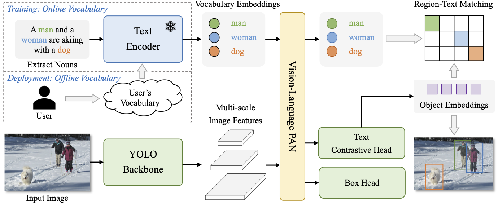
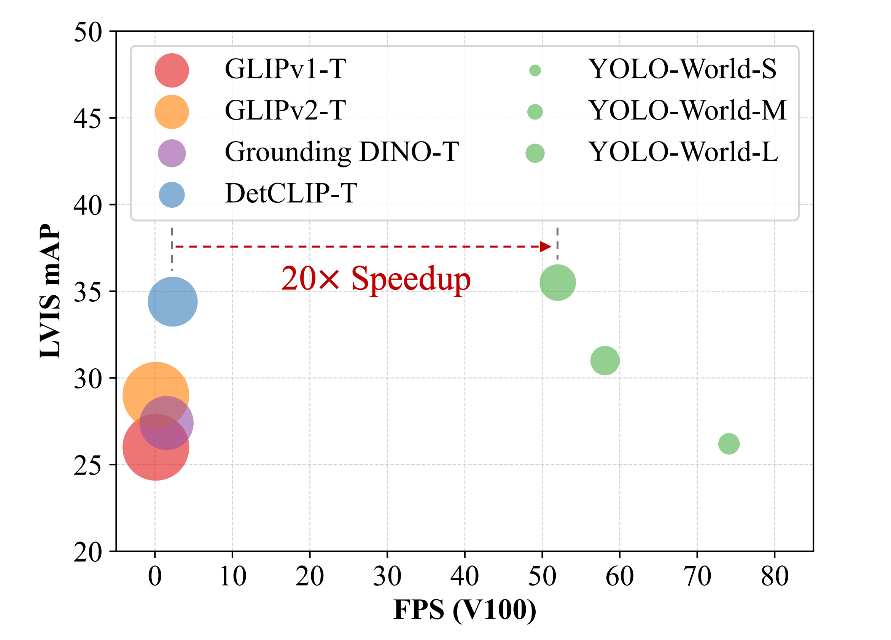
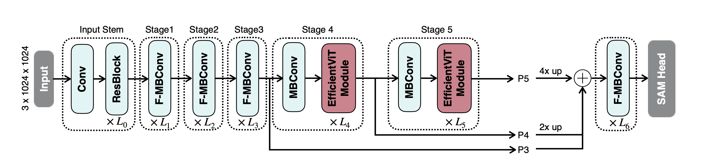
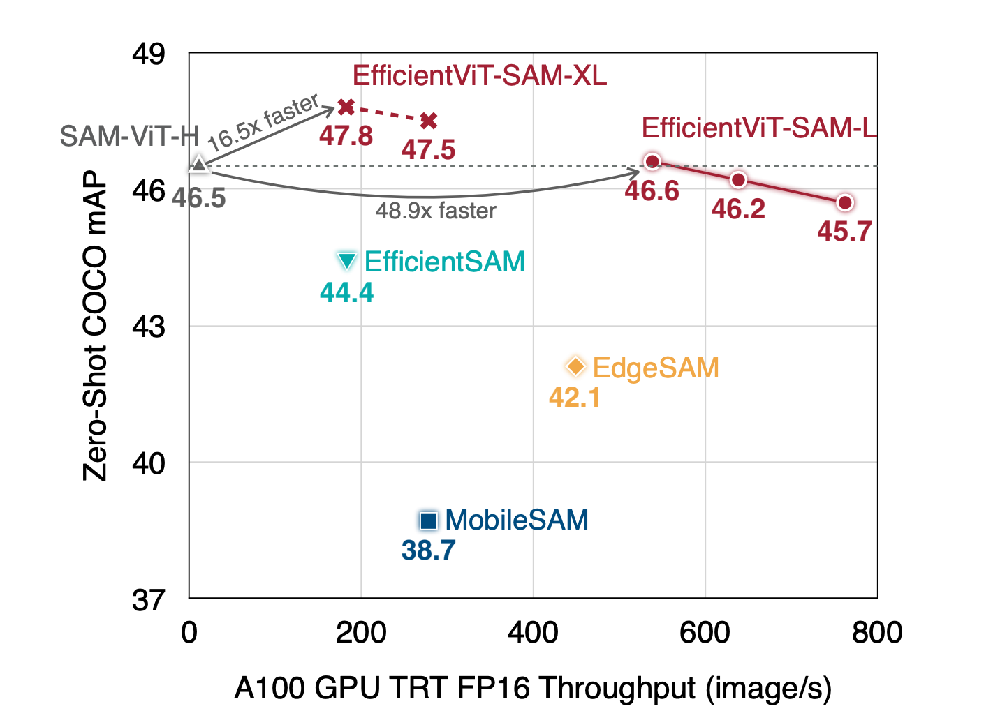
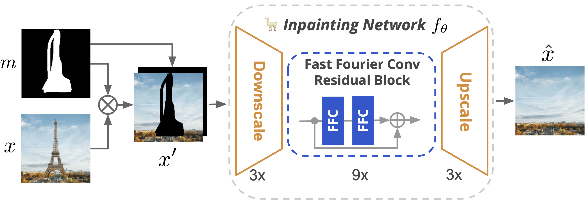

# YOLO-World_EfficientViT-SAM_LaMa

## Getting Started

### Installation

download the pretrained weights from the following links and save them in the `weights` directory.
https://huggingface.co/han-cai/efficientvit-sam/resolve/main/xl1.pt

Use Anaconda to create a new environment and install the required packages.

```
conda create -n yoloworldtest python=3.10 -y

conda activate yoloworldtest

pip install torch torchvision torchaudio --index-url https://download.pytorch.org/whl/cu118

pip install -r requirements.txt
```

### Weights

Download the weights from the following links and save them in the `weights` directory.

```
curl -LJO https://huggingface.co/smartywu/big-lama/resolve/main/big-lama.zip
unzip big-lama.zip
```

[EfficientViT-SAM-XL1](https://huggingface.co/han-cai/efficientvit-sam/resolve/main/xl1.pt)

### Running the Project

```
python app.py
```

## Core Models

### YOLO-World

[YOLO-World](https://github.com/AILab-CVC/YOLO-World) is an open-vocabulary object detection model with high efficiency.
On the challenging LVIS dataset, YOLO-World achieves 35.4 AP with 52.0 FPS on V100,
which outperforms many state-of-the-art methods in terms of both accuracy and speed.




### EfficientViT-SAM

[EfficientViT-SAM](https://github.com/mit-han-lab/efficientvit) is a new family of accelerated segment anything models.
Thanks to the lightweight and hardware-efficient core building block,
it delivers 48.9× measured TensorRT speedup on A100 GPU over SAM-ViT-H without sacrificing performance.




### LaMa

[LaMa](https://github.com/advimman/lama) is an advanced image inpainting method that significantly improves the restoration of large missing areas, complex geometric structures, and high-resolution images through the use of fast Fourier convolutions and high receptive field perceptual loss.



## Citation

```
@article{cheng2024yolow,
  title={YOLO-World: Real-Time Open-Vocabulary Object Detection},
  author={Cheng, Tianheng and Song, Lin and Ge, Yixiao and Liu, Wenyu and Wang, Xinggang and Shan, Ying},
  journal={arXiv preprint arXiv:2401.17270},
  year={2024}
}

@misc{zhang2024efficientvitsam,
  title={EfficientViT-SAM: Accelerated Segment Anything Model Without Performance Loss},
  author={Zhuoyang Zhang and Han Cai and Song Han},
  year={2024},
  eprint={2402.05008},
  archivePrefix={arXiv},
  primaryClass={cs.CV}
}

@article{suvorov2021resolution,
  title={Resolution-robust Large Mask Inpainting with Fourier Convolutions},
  author={Suvorov, Roman and Logacheva, Elizaveta and Mashikhin, Anton and Remizova, Anastasia and Ashukha, Arsenii and Silvestrov, Aleksei and Kong, Naejin and Goka, Harshith and Park, Kiwoong and Lempitsky, Victor},
  journal={arXiv preprint arXiv:2109.07161},
  year={2021}
}
```

## Note

```
Lama refine
lama/configs/prediction/default.yaml
refine: False # refiner will only run if this is True
```
